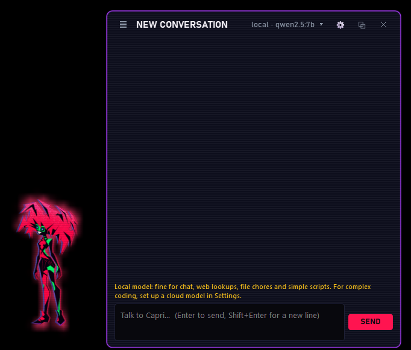
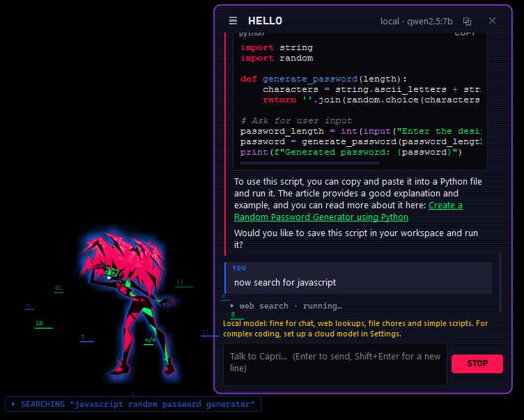

# Capri
> 🚧 **Status: ongoing project.** Features, images and documentation may still change.

A desktop companion for Windows 11: an animated construct that lives on your desktop, chats
with you, searches the web, manages your files and writes and runs simple scripts.





## Disclaimer

Capri is a character from *Cyberpunk: Edgerunners*. This is a non-commercial, unofficial fan
project for personal use, and it is not affiliated with or endorsed by CD Projekt Red, Studio
Trigger or Netflix. All rights to the character belong to their respective owners.

## Features

- Animated character with glitch, glow and scanline effects that react to what she is doing
- Status line under her (`SEARCHING "…"`, `READING report.pdf`, `RUNNING cleanup.py · 3s`)
- Moods, sleep and standby, quiet mode (automatic during fullscreen games and videos)
- Chat panel with streaming answers, code highlighting and saved conversations
- Web search with sources, file management, Python / PowerShell / batch scripts
- Local models through Ollama, or cloud models (OpenAI-compatible APIs, Anthropic)
- Every change to your files and every script needs your confirmation; deleted files go
  to the Recycle Bin; system folders are off limits

## Installation

You need Windows 11, [Python 3.11+](https://www.python.org/downloads/) and
[Ollama](https://ollama.com/download). In PowerShell, inside the project folder:

```powershell
python -m venv .venv
.\.venv\Scripts\Activate.ps1
pip install -r requirements.txt
ollama pull qwen2.5:7b
python main.py
```

Afterwards you can start her with `run_capri.bat` (no console window).
If activation is blocked, run `Set-ExecutionPolicy -Scope CurrentUser RemoteSigned` once.

## Usage

| Action | How |
| --- | --- |
| Open / close the chat | Left-click Capri or the tray icon |
| Move Capri | Drag her. Drop her at a screen edge to dock her there, half hidden |
| Move the chat | Drag its title bar. It then stays where you put it; double-click the title to send it back next to Capri |
| Change the AI model / API key | Click the model name in the chat header (e.g. `local · qwen2.5:7b ▾`), or *AI model…* in the menu |
| Detach the chat | `⧉` button (normal resizable window) |
| Conversations | `☰` button: new, rename, delete, reopen |
| Menu | Right-click Capri or the tray icon: chat, quiet mode, AI model, settings, reload assets, quit |

Example requests: *"What's new in Python 3.13? Give me sources."*, *"Move the screenshots
on my Desktop into a folder called Screenshots."*, *"Write a script that renames every
.jpeg in Pictures\Trip to .jpg and run it."*

**AI model:** open the model window from the chat header. Ollama is the default and needs no
key. For cloud models, pick *OpenAI-compatible API* or *Anthropic API* and paste your key.
*Fetch* lists the available models and *Test connection* checks that everything works. Local models are fine for
simple tasks and scripts; a cloud model is recommended for complex coding.

**Where things are stored:** settings and API keys in `%APPDATA%\Capri\settings.json`,
conversations in `%APPDATA%\Capri\conversations\`, logs in `%APPDATA%\Capri\logs\`, scripts
in `%USERPROFILE%\CapriWorkspace`.

## Character images

Put PNG files with a transparent background in `assets/character/`, all the same size
(512×512 recommended), with the character facing **right**. Then choose *Reload assets*.
Without images, an abstract placeholder is drawn.

| File | Used when | If missing |
| --- | --- | --- |
| `idle.png` | Default | placeholder |
| `blink.png` | Blinking | `idle` |
| `happy.png` | After answering | `idle` |
| `talking.png` | Writing an answer | `idle` |
| `thinking.png` | Waiting for the model | `idle` |
| `searching.png` | Web search | `thinking` → `idle` |
| `files.png` | File operations | `thinking` → `idle` |
| `coding.png` | Scripts | `thinking` → `idle` |
| `alert.png` | Waiting for your confirmation | `idle` |
| `error.png` | Something failed | `alert` → `idle` |
| `sleeping.png` | Asleep | `idle` |
| `standby.png` | Long idle | only a glowing core remains |
| `peek.png` | Docked at a screen edge | `idle` |

For animations, use numbered frames instead (`idle_1.png`, `idle_2.png`, …). Frame rates can
be set in `assets/character/animation.json` (see `animation.example.json`). The app icon is
`assets/icon.ico`.

Colors, fonts and effect settings live in `assets/theme.json`. Main palette: `#08080D` ink
black, `#0F1020` panel navy, `#FF1450` crimson (accent), `#12F56C` acid green, `#A23BF2`
violet (borders), `#2A6BFF` blue, `#FF8DB4` pink, `#FFC61A` yellow (warnings), `#FF8A1F`
amber (alerts), `#FF3030` red (errors).

## Troubleshooting

- **"I can't reach Ollama"**: start the Ollama app.
- **"Ollama doesn't have the model"**: run `ollama pull qwen2.5:7b` or change the model in Settings.
- **"The API key was rejected"**: paste the key again in *Settings → Brain*.
- **Capri is off-screen**: quit, delete the `window` block in `settings.json`, restart.
- **Slow PC**: set *Effects intensity* to subtle or off.
- **Anything else**: check `%APPDATA%\Capri\logs\capri.log`.

## Project structure

```text
main.py            entry point
capri/app.py       wires everything together
capri/character/   character window, effects, images, mood
capri/llm/         model backends (one file each in providers/) and the agent loop
capri/tools/       web, file and script tools, safety checks
capri/ui/          chat panel, dialogs, styling
assets/            theme.json and character images
tests/             unit tests (python -m pytest)
```

## AI

This software, including its source code and documentation, was generated entirely by
Claude Fable 5.2 and Claude Opus 5.5, artificial intelligence models developed by Anthropic,
through the methodology known as "vibe coding". The character images were generated with
ChatGPT Images by OpenAI. The software is provided "as is", without warranty of any kind,
and users are advised to review the code before executing it.
